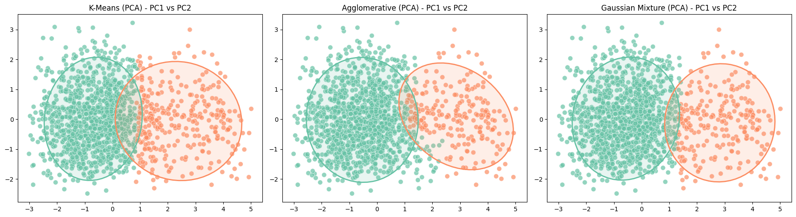
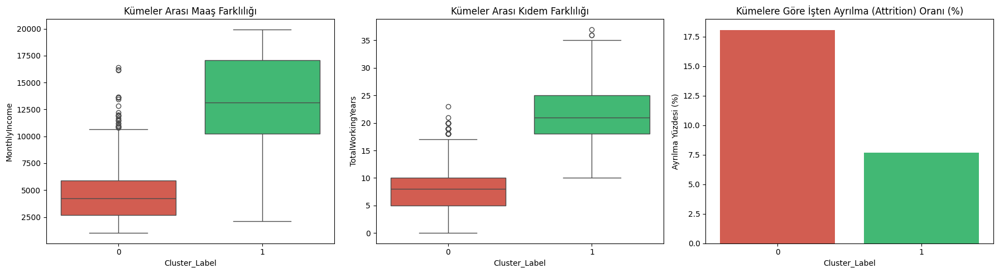

# HR Attrition Segmentation with Clustering & PCA


**🇬🇧 English** · [🇹🇷 Türkçe](#-türkçe)

Unsupervised segmentation of employees in the **IBM HR Analytics Attrition** dataset (1,470 employees, 35 features) to identify the profiles most likely to leave the company. The project compares several clustering algorithms in the original feature space and after **Principal Component Analysis (PCA)**, then turns the best clusters into actionable HR personas.

## Key results

| Model | Silhouette ↑ | Davies-Bouldin ↓ | Calinski-Harabasz ↑ |
|---|---:|---:|---:|
| K-Means | 0.231 | 1.788 | 314.0 |
| Agglomerative (Ward) | 0.282 | 1.530 | 273.9 |
| Gaussian Mixture | 0.162 | 2.281 | 234.0 |
| K-Means **(PCA)** | 0.461 | 0.851 | 1184.6 |
| Agglomerative **(PCA)** | 0.478 | **0.749** | 1028.1 |
| **Gaussian Mixture (PCA)** | **0.492** | 0.752 | 1126.4 |
| K-Prototypes (mixed data, PCA) | 0.448 | 0.886 | – |

PCA roughly **doubled the silhouette score** of every model. The final segmentation uses **GMM on PCA components**:

| Cluster | Avg. age | Avg. monthly income | Total working years | **Attrition rate** |
|---|---:|---:|---:|---:|
| 0 – Early-career | 34.3 | $4,678 | 8.2 | **18.1 %** |
| 1 – Senior / established | 45.8 | $12,846 | 21.7 | **7.7 %** |

> **Insight:** Younger, lower-paid employees with shorter tenure leave **2.3× more often**. Retention programs, career planning and compensation reviews should target this segment first.

<p align="center">
  <br>
  
</p>

## Methodology

1. **EDA & cleaning** – drop constant/ID columns (`EmployeeCount`, `Over18`, `StandardHours`, `EmployeeNumber`); hold out `Attrition` for evaluation only.
2. **Outlier removal** – multivariate anomaly detection with **Isolation Forest** (5 % contamination).
3. **Scaling** – `StandardScaler` on continuous variables.
4. **Choosing k** – Elbow method, AIC/BIC curves for GMM.
5. **Modeling** – K-Means, Agglomerative (Ward), Gaussian Mixture and **K-Prototypes** for mixed numeric + categorical data.
6. **Dimensionality reduction** – PCA, then re-training and comparison with Silhouette, Davies-Bouldin and Calinski-Harabasz.
7. **Profiling** – cluster means, attrition rate per cluster and PC1 loadings (`TotalWorkingYears`, `MonthlyIncome`, `Age`, `YearsAtCompany`).

## Repository structure

```
├── notebooks/
│   ├── 01_attrition_clustering_pca.ipynb          # main analysis (start here)
│   ├── 02_pca_variance_kprototypes_personas.ipynb # PCA (90 % variance) + K-Prototypes personas
│   └── clustering-studies/
│       ├── gmm_mnist.ipynb                        # GMM on MNIST, AMI & BIC model selection
│       ├── dbscan_wholesale_customers.ipynb       # DBSCAN eps / min_samples tuning
│       └── kmeans_iris.ipynb                      # K-Means, silhouette & elbow on Iris
├── assets/                                        # figures used in this README
├── requirements.txt
└── LICENSE
```

## Getting started

```bash
git clone https://github.com/4hmetcakmak/hr-attrition-clustering-pca.git
cd hr-attrition-clustering-pca
pip install -r requirements.txt
jupyter notebook notebooks/01_attrition_clustering_pca.ipynb
```

The dataset is loaded directly from a public URL, so no manual download is required.

## Dataset

[IBM HR Analytics Employee Attrition & Performance](https://www.kaggle.com/datasets/pavansubhasht/ibm-hr-analytics-attrition-dataset) – a fictional dataset created by IBM data scientists.

---

## 🇹🇷 Türkçe

**IBM HR Analytics** veri seti (1.470 çalışan, 35 değişken) üzerinde, işten ayrılma riski yüksek çalışan profillerini **denetimsiz öğrenme** ile tespit eden bir İK analitiği projesi. Kümeleme algoritmaları hem orijinal uzayda hem de **Temel Bileşenler Analizi (PCA)** sonrasında karşılaştırılmış, en iyi model ile İK personaları çıkarılmıştır.

### Öne çıkan sonuçlar

- PCA, tüm modellerin **Silhouette skorunu yaklaşık iki katına** çıkardı (ör. GMM: 0.16 → **0.49**).
- Nihai model **PCA + Gaussian Mixture**, çalışanları iki kümeye ayırdı:
  - **Küme 0 – Kariyerin başındakiler:** ort. 34 yaş, ~$4.7K aylık gelir → **%18,1 ayrılma oranı**
  - **Küme 1 – Kıdemli çalışanlar:** ort. 46 yaş, ~$12.8K aylık gelir → **%7,7 ayrılma oranı**
- **Aksiyon önerisi:** Genç, düşük gelirli ve kıdemi az çalışanlar **2,3 kat** daha fazla ayrılıyor; yetenek tutma, kariyer planlama ve ücret politikaları öncelikle bu gruba yönelmeli.

### Yöntem

Keşifçi veri analizi → **Isolation Forest** ile aykırı değer temizliği → standartlaştırma → Dirsek yöntemi ve AIC/BIC ile küme sayısı seçimi → K-Means, Hiyerarşik, GMM ve karma veri için **K-Prototypes** → PCA sonrası yeniden eğitim → Silhouette, Davies-Bouldin ve Calinski-Harabasz ile karşılaştırma → küme profilleme.

`notebooks/clustering-studies/` klasöründe ise MNIST üzerinde GMM, toptan satış müşteri verisinde DBSCAN ve Iris üzerinde K-Means çalışmaları yer almaktadır.

### Çalıştırma

```bash
pip install -r requirements.txt
jupyter notebook notebooks/01_attrition_clustering_pca.ipynb
```

---

**Author / Yazar:** Ahmet Çakmak · [GitHub](https://github.com/4hmetcakmak)
